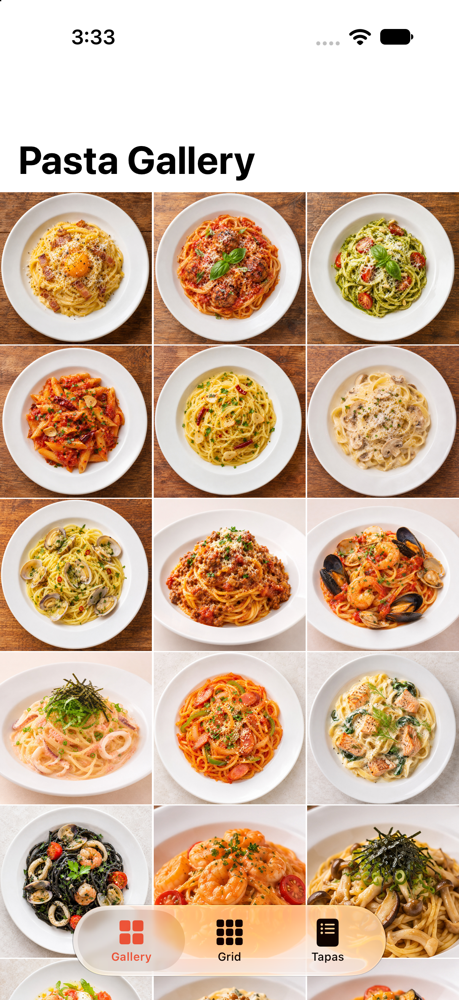
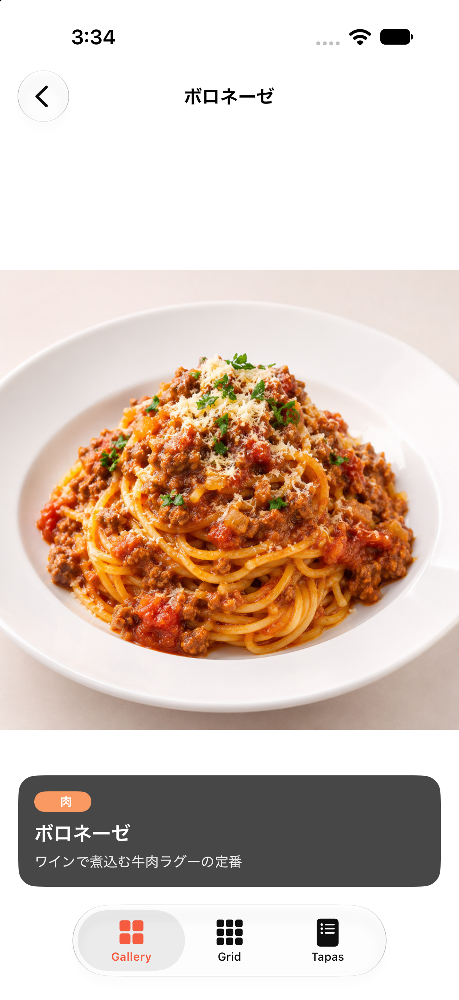
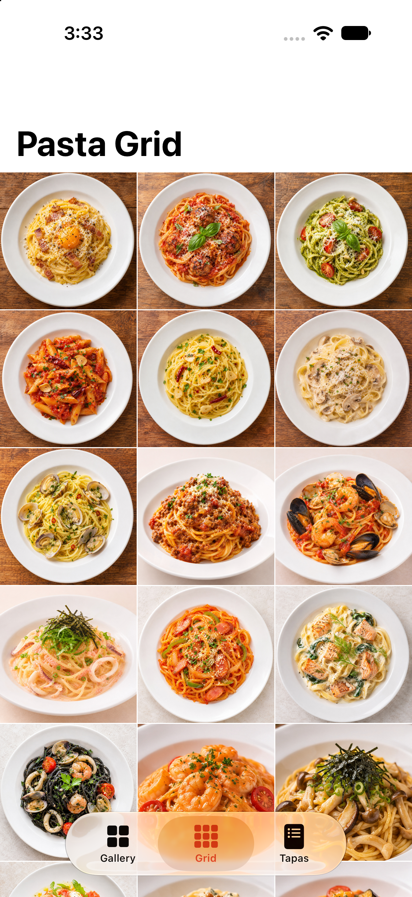
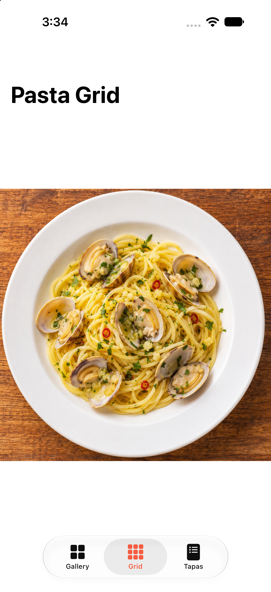
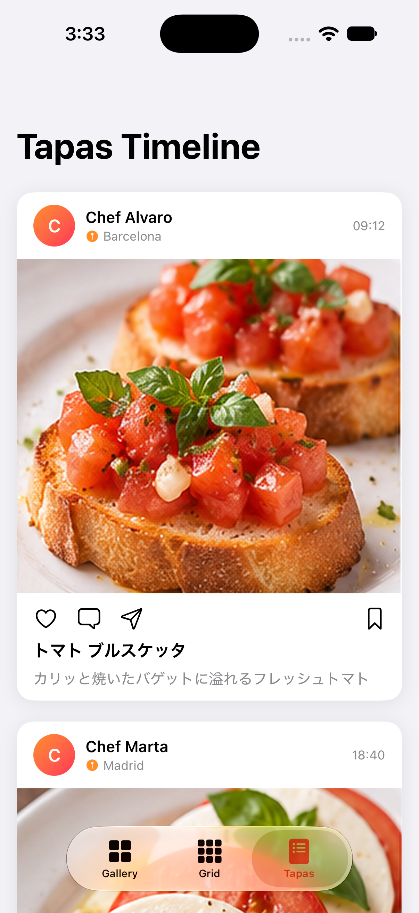
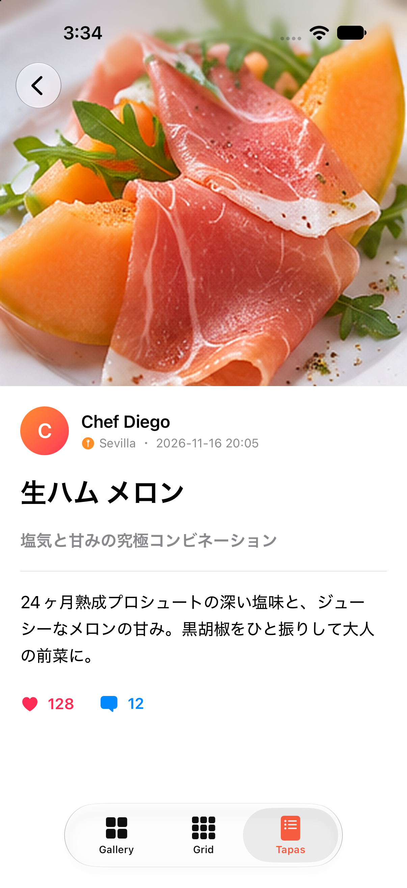
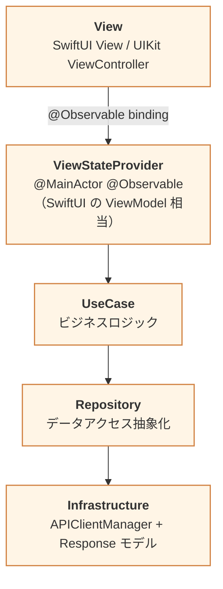
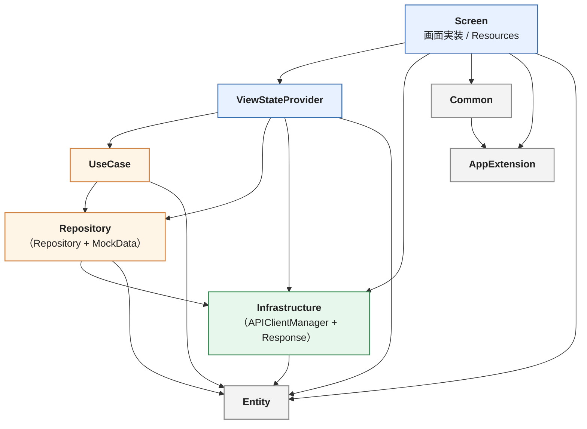

# MatchedGeometryEffectShowcase

UIKit と SwiftUI における画面遷移表現の違いを比較検証するためのサンプル iOS アプリケーションです。
パスタとタパスをテーマにした 3 つのギャラリー画面を通じて、それぞれの UI 技術における「滑らかで魅力的な画面遷移」の実装パターンを題材にしています。

---

## 目次

- [概要](#概要)
- [スクリーンショット](#スクリーンショット)
- [機能一覧](#機能一覧)
- [技術スタック](#技術スタック)
- [アーキテクチャ](#アーキテクチャ)
- [プロジェクト構成](#プロジェクト構成)
- [ビルド・実行手順](#ビルド実行手順)
- [テスト](#テスト)
- [実装のポイント](#実装のポイント)
- [参考実装](#参考実装)

---

## 概要

本プロジェクトは、以下 3 種類の画面遷移表現をひとつのアプリ上で比較できる構成になっています。

| タブ | UI 技術 | 遷移手法 |
| --- | --- | --- |
| Pasta Gallery | UIKit (Storyboard) | `UIViewControllerAnimatedTransitioning` を実装したカスタムトランジション + Pan to Dismiss |
| Pasta Grid | SwiftUI | `@Namespace` + `matchedGeometryEffect` によるヒーロー遷移 + Drag Gesture Dismiss |
| Tapas Timeline | SwiftUI | `.matchedTransitionSource` + `.navigationTransition(.zoom)` による Zoom 遷移 |

---

## スクリーンショット

各タブについて、一覧画面と拡大 / 詳細画面を並べて掲載します。

### Tab 1: Pasta Gallery (UIKit)

<table>
  <tr>
    <th align="center" width="50%">一覧</th>
    <th align="center" width="50%">拡大 / 詳細</th>
  </tr>
  <tr>
    <td align="center"></td>
    <td align="center"></td>
  </tr>
  <tr>
    <td>Storyboard + <code>UICollectionViewFlowLayout</code> による 3 列 1pt グリッド。</td>
    <td>セルをタップすると、サムネイル画像が浮き上がって拡大しながら詳細画面へ遷移。下方向へのドラッグで Interactive Dismiss。</td>
  </tr>
</table>

### Tab 2: Pasta Grid (SwiftUI)

<table>
  <tr>
    <th align="center" width="50%">一覧</th>
    <th align="center" width="50%">拡大 / 詳細</th>
  </tr>
  <tr>
    <td align="center"></td>
    <td align="center"></td>
  </tr>
  <tr>
    <td><code>LazyVGrid</code> による 3 列 1pt グリッド。</td>
    <td>セルをタップすると <code>matchedGeometryEffect</code> で拡大表示にモーフィング。拡大画像を上下にドラッグすると背景のグリッドが段階的に透過する。</td>
  </tr>
</table>

### Tab 3: Tapas Timeline (SwiftUI)

<table>
  <tr>
    <th align="center" width="50%">一覧</th>
    <th align="center" width="50%">拡大 / 詳細</th>
  </tr>
  <tr>
    <td align="center"></td>
    <td align="center"></td>
  </tr>
  <tr>
    <td>縦長カードタイムライン（著者ヘッダー / 本文画像 / アクションバー / キャプション）。</td>
    <td>iOS 18 新 API の <code>.matchedTransitionSource</code> + <code>.navigationTransition(.zoom)</code> によるカード画像の Zoom 遷移。</td>
  </tr>
</table>

---

## 機能一覧

### Tab 1: Pasta Gallery (UIKit)

- **レイアウト**: `UICollectionViewFlowLayout` による 3 列 1pt グリッド
- **データソース**: パスタ 24 品（カルボナーラ / ジェノベーゼ / ボロネーゼ 等）
- **画面遷移**:
  - Push: 選択セルの位置から詳細画面のヒーロー画像位置へ、スナップショット `UIImageView` が `UIViewPropertyAnimator` によって滑らかに移動
  - Pop: 詳細画面 → Grid セル位置へ復帰
  - Interactive Dismiss: 詳細画面を下方向にドラッグすると、画像が縮小 (`CGAffineTransform.scale`) + 追従しながら前画面に戻る
- **Navigation**: `UINavigationBar.prefersLargeTitles` を有効化し、SwiftUI 側 (`navigationBarTitleDisplayMode(.large)`) と視覚的に統一

### Tab 2: Pasta Grid (SwiftUI)

- **レイアウト**: `LazyVGrid` による 3 列 1pt グリッド（角丸なし）
- **画面遷移**: `@Namespace` + `matchedGeometryEffect(id:, in:, isSource:)` による本体 ↔ 詳細のモーフィング
- **拡大画像の Dismiss**:
  - 上下ドラッグで `offset` を更新し画像が追従
  - ドラッグ量 (0 → 200pt) に応じて背景グリッドが `opacity 0 → 1` に段階的に透過
  - 閾値 200pt 超で Dismiss / 未満で `.spring` により復帰
- **アニメーション**: `.spring(response: 0.36, dampingFraction: 0.48)` で一貫

### Tab 3: Tapas Timeline (SwiftUI)

- **レイアウト**: Instagram 風の縦長カードタイムライン（著者ヘッダー / 本文画像 / アクションバー / キャプション）
- **データソース**: タパス 10 品（ブルスケッタ / アヒージョ / トルティージャ 等）
- **画面遷移**: iOS 18 新 API の `.matchedTransitionSource(id:, in:)` + `.navigationTransition(.zoom(sourceID:, in:))` により、カード画像がそのまま拡大して詳細画面へズーム遷移

---

## 技術スタック

| カテゴリ | 採用技術 |
| --- | --- |
| 言語 | Swift 6 (Swift Language Mode v5 per-target) |
| プラットフォーム | iOS 18.0+ |
| UI フレームワーク | SwiftUI (2 タブ) / UIKit + Storyboard (1 タブ) |
| 状態管理 | Observation Framework (`@Observable`) |
| 非同期処理 | Swift Concurrency (`async/await`, `Task`, `@MainActor`) |
| パッケージ管理 | Swift Package Manager (マルチモジュール構成) |
| テストフレームワーク | swift-testing (`@Suite`, `@Test`, `#expect`) |
| ビルドターゲット | Xcode Project + Local Swift Package |

---

## アーキテクチャ

### レイヤー構成

MVVM に近い構成を採用。View からの一方向のデータフローと、Observation Framework によるデータバインディングで状態を伝播させます。



**データフォールバック**: 各 `Repository` は `http://localhost:3000/api/v1/*` へ API リクエストを試みた後、ネットワークエラー時には `PastaMockData` / `TapasMockData` のローカルモックデータを返却する実装になっています。これにより、バックエンドサーバーがなくても動作検証が可能です。

### モジュール構成 (Swift Package)

```
AppFeature/Sources/
├── Entity                 ... ドメインエンティティ (PastaEntity, TapasEntity)
├── AppExtension           ... 共通拡張 (UIColor, StoryboardInstantiatable, CGExtension)
├── Infrastructure         ... APIClientManager + Response DTO
├── Repository             ... Repository + MockData
├── UseCase                ... UseCase 層
├── ViewStateProvider      ... @Observable @MainActor ViewModel 相当
├── Common                 ... 共通 SwiftUI View (ConnectionErrorView)
└── Screen                 ... 画面実装 (UIKit / SwiftUI) + Resources (xcassets / storyboard)
```

モジュール間の依存関係 (`Package.swift` にて定義):



---

## プロジェクト構成

```
MatchedGeometryEffectShowcase/
├── docs/
│   └── screenshots/                       ... README 用スクリーンショット
├── iOSApp/
│   ├── MatchedGeometryEffectShowcase.xcodeproj
│   ├── MatchedGeometryEffectShowcase/
│   │   ├── Application/
│   │   │   └── ContentView.swift          ... 3-Tab TabView のルート
│   │   └── MatchedGeometryEffectShowcaseApp.swift
│   └── Packages/
│       └── AppFeature/
│           ├── Package.swift
│           ├── Sources/
│           │   ├── Entity/
│           │   │   ├── PastaEntity.swift
│           │   │   └── TapasEntity.swift
│           │   ├── Infrastructure/
│           │   │   ├── APIClientManager.swift
│           │   │   └── Response/
│           │   │       ├── PastaResponse.swift
│           │   │       └── TapasResponse.swift
│           │   ├── Repository/
│           │   │   ├── PastaRepository.swift
│           │   │   ├── PastaMockData.swift
│           │   │   ├── TapasRepository.swift
│           │   │   └── TapasMockData.swift
│           │   ├── UseCase/
│           │   │   ├── PastaUseCase.swift
│           │   │   └── TapasUseCase.swift
│           │   ├── ViewStateProvider/
│           │   │   ├── PastaStateProvider.swift
│           │   │   └── TapasStateProvider.swift
│           │   ├── AppExtension/
│           │   │   ├── CGExtension.swift
│           │   │   ├── StoryboardInstantiatable.swift
│           │   │   └── UIColorExtension.swift
│           │   ├── Common/
│           │   │   └── ConnectionErrorView.swift
│           │   └── Screen/
│           │       ├── PastaGalleryScreen/             ... Tab 1 (UIKit)
│           │       │   ├── PastaGalleryScreenView.swift        (SwiftUI ↔ UIKit Bridge)
│           │       │   ├── PastaGalleryNavigationController.swift
│           │       │   ├── PastaGalleryViewController.swift
│           │       │   ├── PastaDetailViewController.swift
│           │       │   ├── Cell/
│           │       │   │   └── PastaMosaicCell.swift
│           │       │   └── Transition/
│           │       │       ├── PastaDetailTransitionAnimatorDelegate.swift
│           │       │       ├── PastaDetailPushTransition.swift
│           │       │       ├── PastaDetailPopTransition.swift
│           │       │       └── PastaDetailInteractiveDismissTransition.swift
│           │       ├── PastaGridScreen/                ... Tab 2 (SwiftUI)
│           │       │   └── PastaGridScreenView.swift
│           │       ├── TapasTimelineScreen/            ... Tab 3 (SwiftUI)
│           │       │   └── TapasTimelineScreenView.swift
│           │       └── Resources/
│           │           ├── PastaGalleryViewController.storyboard
│           │           └── FoodImages.xcassets/
│           │               ├── Pasta/pasta_01..24     (24 枚)
│           │               └── Tapas/tapas_01..10     (10 枚)
│           └── Tests/
│               ├── UseCaseTests/
│               │   ├── PastaUseCaseTests.swift
│               │   └── TapasUseCaseTests.swift
│               └── RepositoryTests/
│                   └── MockDataTests.swift
└── README.md
```

---

## ビルド・実行手順

### 前提環境

- macOS 14+ / Xcode 16+ (iOS 18 SDK 対応)
- iPhone シミュレータまたは実機 (iOS 18.0 以降)

### 手順

```bash
# リポジトリ取得
git clone <this-repository>
cd MatchedGeometryEffectShowcase/iOSApp

# Xcode で開く
open MatchedGeometryEffectShowcase.xcodeproj
```

Xcode 上でスキーム **MatchedGeometryEffectShowcase** を選択し、任意の iOS 18 シミュレータを指定して Run (⌘R)。

### CLI からのビルド検証

```bash
cd iOSApp
xcodebuild \
  -project MatchedGeometryEffectShowcase.xcodeproj \
  -scheme MatchedGeometryEffectShowcase \
  -destination 'generic/platform=iOS Simulator' \
  -configuration Debug build
```

---

## テスト

swift-testing (`@Suite` / `@Test`) によるユニットテストを `AppFeature/Tests` 配下に配置しています。

| テストターゲット | テスト対象 |
| --- | --- |
| `UseCaseTests/PastaUseCaseTests` | `PastaUseCase.fetchAll` / `fetchByID` の正常系・異常系・モック依存性注入 |
| `UseCaseTests/TapasUseCaseTests` | `TapasUseCase.fetchAll` / `fetchByID` |
| `RepositoryTests/MockDataTests` | `PastaMockData` / `TapasMockData` の件数・ID 連番性・imageName フォーマット整合性 |

### テスト実行 (CLI)

```bash
cd iOSApp
xcodebuild test \
  -project MatchedGeometryEffectShowcase.xcodeproj \
  -scheme MatchedGeometryEffectShowcase \
  -destination 'platform=iOS Simulator,name=iPhone 18 Pro'
```

---

## 実装のポイント

### 1. UIKit カスタムトランジション (Pasta Gallery)

#### クラス構成

| クラス | 役割 |
| --- | --- |
| `PastaGalleryNavigationController` | `UINavigationControllerDelegate` を実装し、Push / Pop 時に Animator を切り替える |
| `PastaDetailPushTransition` | Grid → Detail 遷移。スナップショット `UIImageView` を `UIViewPropertyAnimator(dampingRatio: 0.93)` で拡大 |
| `PastaDetailPopTransition` | Detail → Grid 遷移。スナップショットを Grid セル位置へ縮小 |
| `PastaDetailInteractiveDismissTransition` | `UIPercentDrivenInteractiveTransition` の派生。`UIPanGestureRecognizer` の進捗を `scaleAndShift` で 0〜1 に正規化し、`transitionImageView.transform = scale × translate` で追従 |
| `PastaDetailTransitionAnimatorDelegate` | 遷移中に対象セルを非表示化 / 画像フレームを提供するプロトコル |

#### 遷移情報の受け渡し

`PastaGalleryViewController` は `PastaDetailTransitionAnimatorDelegate` に準拠し、以下の情報を Animator 側に提供します。

```swift
func referenceImage() -> UIImage? {
    (collectionView.cellForItem(at: selectedIndexPath) as? PastaMosaicCell)?.thumbnailImageView.image
}

func imageFrame() -> CGRect? {
    guard let cell = collectionView.cellForItem(at: selectedIndexPath) else { return nil }
    return collectionView.convert(cell.frame, to: self.view)
}
```

### 2. matchedGeometryEffect (Pasta Grid)

- 親 (`PastaGridScreenView`) で `@State var selectedPasta`、`@State var selectedImage`、`@State var dragPosition` を管理
- 子 (`PastaSelectedImageView`) は `@Binding` で受け取り、Drag Gesture により `dragPosition` を更新
- グリッド側の opacity は `dragProgress = min(|dragPosition.height| / 200, 1.0)` で算出し、ドラッグ中に下のグリッドが段階的に透過

```swift
.matchedGeometryEffect(id: "pasta-\(pasta.id)",
                       in: namespace,
                       isSource: selectedImage == nil)
```

### 3. navigationTransition (Tapas Timeline)

iOS 18 新 API を活用し、わずか数行で Zoom トランジションを実現。

```swift
NavigationLink {
    TapasDetailView(tapas: tapas)
        .navigationTransition(.zoom(sourceID: tapas.id, in: tapasNamespace))
} label: {
    TapasTimelineCard(tapas: tapas)
        .matchedTransitionSource(id: tapas.id, in: tapasNamespace)
}
```

### 4. Observation Framework によるデータバインディング

`@Observable @MainActor` の ViewStateProvider を SwiftUI では `@State` で、UIKit では `withObservationTracking` で追跡します。

**UIKit 側の例 (`PastaGalleryViewController`):**

```swift
private func bindStateProvider() {
    withObservationTracking {
        _ = stateProvider.pastaList
    } onChange: { [weak self] in
        Task { @MainActor in
            self?.collectionView.reloadData()
            self?.bindStateProvider()  // 次のトラッキングを再登録
        }
    }
}
```

---

## License

本プロジェクトはサンプル実装です。ライセンス方針については別途定めてください。
